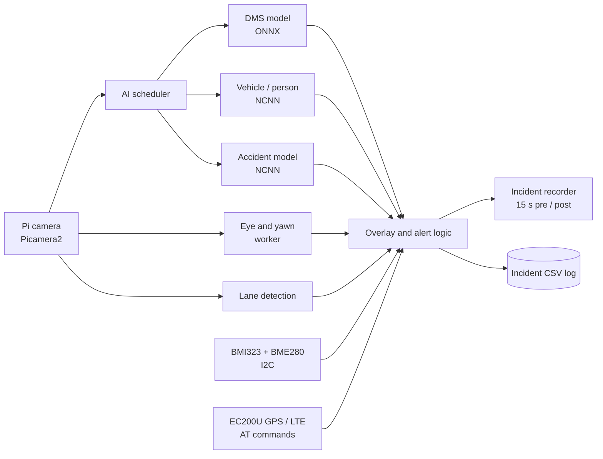

<div align="center">


**An edge-AI dashcam that watches both the driver and the road, records incident clips, and logs location and sensor data.**

</div>

<!-- DEMO: after adding media/demo.gif, uncomment
<p align="center"></p>
-->

---

## ✨ Features

| Area | What it does |
|---|---|
| 🧑‍✈️ **Driver monitoring** | YOLO (ONNX) detects **phone use, seatbelt, cigarette and smoking**; an eye and yawn detector runs in a separate worker |
| 🚗 **Road awareness** | NCNN YOLO detects **vehicles and people**; **lane detection** with lane-departure flagging |
| 💥 **Accident detection** | Dedicated NCNN accident model with a 2 s hold, plus an **IoU-based collision fallback** |
| 🎞️ **Incident recorder** | Saves annotated clips with **15 s pre-roll and 15 s post-roll**, a bounded frame queue, free-space checks and a fallback folder |
| 📍 **GPS and network** | Quectel **EC200U** over AT commands: location, speed, altitude, network registration and signal strength |
| 🌡️ **Motion and environment** | **BMI323** IMU and **BME280** (temperature, pressure, humidity) over I2C, drawn as an on-screen overlay |
| 🗂️ **Event log** | Every incident transition is written to `dms_incident_log.csv` with GPS and sensor values |
| ⚙️ **CPU-aware design** | Single-threaded BLAS/OpenCV/Torch settings, worker threads and thread affinity for a small board; 25 FPS output target |

## 🧩 Architecture



## 🔌 Hardware

| Part | Used for |
|---|---|
| Raspberry Pi with CSI camera (Picamera2) | Compute and video |
| Quectel EC200U module (USB serial, `/dev/ttyUSB0`) | GPS location and cellular status |
| BMI323 IMU (I2C `0x68`) | Acceleration and rotation |
| BME280 (I2C `0x76`) | Temperature, pressure, humidity |

## 📁 Repository structure

```
.
├── final_code.py          # main application
├── detectors/             # eye_yawn_detector.py goes here
├── models/yolo/           # best.onnx and best_ncnn_model/ (not in git)
├── media/                 # demo GIF / video
├── docs/images/           # banner
├── requirements.txt
└── LICENSE
```

## 🚀 Getting started

1. **Environment** (on the Pi): `sudo apt install python3-picamera2`, then create a virtual environment that can see system packages and run `pip install -r requirements.txt`.
2. **Models:** place `best.onnx` and `best_ncnn_model/` in `models/yolo/`. Set `VEHICLE_MODEL` (near line 623 of `final_code.py`) to your vehicle/person model folder.
3. **Detector module:** `detectors/eye_yawn_detector.py` must exist (see the note in that folder).
4. **Run:**
   ```
   python final_code.py
   python final_code.py --record -o output.mp4
   ```

| Option | Meaning |
|---|---|
| `--record`, `-o` | Save the annotated live feed to a file |
| `--no-incident-clips` | Turn off automatic incident clips |
| `--incident-dir`, `--incident-fallback-dir` | Where incident clips are saved |
| `--incident-pre`, `--incident-post` | Seconds saved before and after an alert (default 15 and 15) |
| `--incident-max-clip`, `--incident-min-free-gb`, `--incident-queue-size` | Clip length, free-space and queue limits |
| `--width`, `--height` | Camera resolution (default 1280x720) |
| `--gps-port`, `--gps-baud` | EC200U serial port and speed (default `/dev/ttyUSB0`, 115200) |

Press `q` in the preview window to quit (see the key handling in `main()`).

## 🗺️ Status and next steps

- [x] Driver monitoring, road detection, accident detection, lane departure
- [x] Incident clip recorder, GPS and sensor logging
- [ ] Add measured results (FPS, accuracy) once benchmarked
- [ ] Add a demo video and GIF
- [ ] Package models for easy download

## ⚠️ Notes

- Prototype for research and learning, not a certified safety product.
- Review recorded footage for privacy before sharing it publicly.

## 📄 License

MIT. See [LICENSE](LICENSE). Check the licenses of the models and libraries you use (for example, Ultralytics YOLO is AGPL-3.0).
